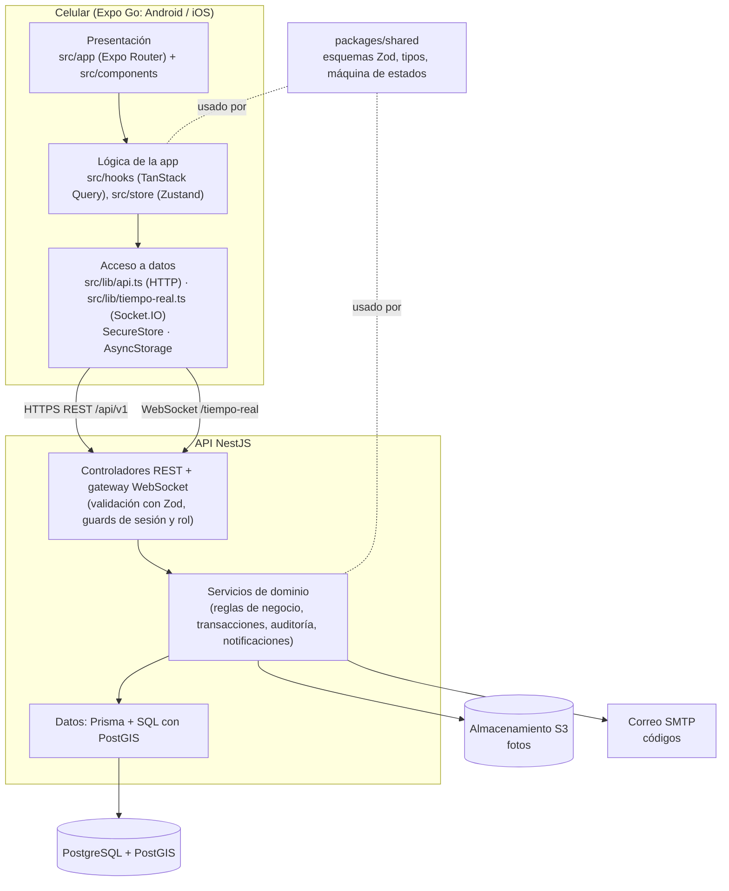
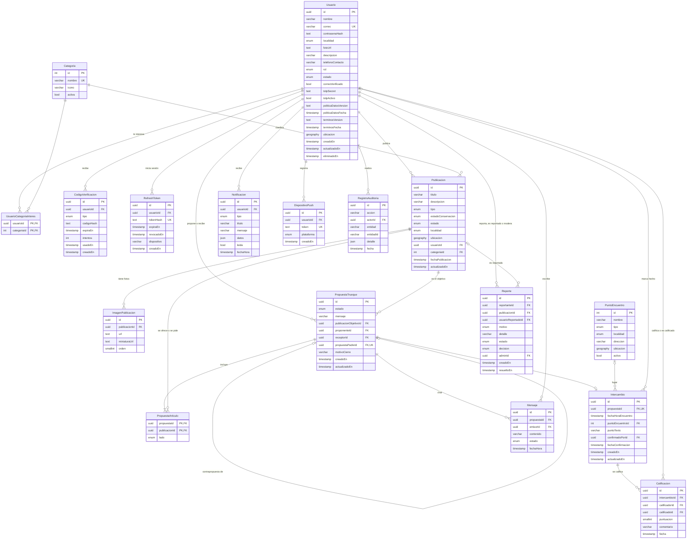

# Documentación técnica del prototipo: Trueque Comunitario

**Trabajo de grado:** _Diseño de una aplicación móvil de trueque comunitario para fomentar la economía colaborativa en Bogotá_. Universidad Manuela Beltrán, 2026.

**Repositorio:** monorepo `trueque-comunitario`, versión 0.1.0.

Este documento describe solo lo que existe en el código a la fecha del último commit (20 de noviembre de 2026). Cuando algo no está implementado se indica como **No implementado**. No incluye contraseñas, tokens ni valores de variables de entorno.

---

## Contenido

1. [Resumen técnico](#1-resumen-técnico)
2. [Stack tecnológico](#2-stack-tecnológico)
3. [Arquitectura](#3-arquitectura)
4. [Modelo de base de datos](#4-modelo-de-base-de-datos)
5. [API](#5-api)
6. [Trazabilidad de requerimientos](#6-trazabilidad-de-requerimientos)
7. [Pantallas](#7-pantallas)
8. [Seguridad](#8-seguridad)
9. [Pruebas](#9-pruebas)
10. [Manual de instalación](#10-manual-de-instalación)
11. [Manual de usuario breve](#11-manual-de-usuario-breve)
12. [Control de versiones](#12-control-de-versiones)
13. [Sprints](#13-sprints)
14. [Licencia](#14-licencia)
15. [Diferencias con el diseño](#15-diferencias-con-el-diseño)

---

## 1. Resumen técnico

Trueque Comunitario es una aplicación móvil (Android e iOS) para intercambiar bienes y servicios **sin dinero** entre ciudadanos de las localidades piloto de Bogotá: Suba, Kennedy y Teusaquillo.

**Qué hace hoy:**

- **Cuentas:** registro con aceptación de la política de datos y de los términos, verificación del correo con un código de 6 dígitos, inicio de sesión con verificación en dos pasos opcional (TOTP), recuperación de la contraseña y perfil con foto, localidad e intereses.
- **Publicaciones:** de bienes o servicios, con hasta 5 fotos, categoría, estado de conservación y ubicación aproximada. Se pueden editar, cambiar de estado y eliminar.
- **Búsqueda:**
  - por palabra clave en español, sin importar tildes;
  - con filtros por categoría, tipo, estado del objeto, localidad y radio de 1 a 10 km;
  - en lista o en mapa, mostrando la distancia aproximada.
- **Trueque completo:**
  - proponer ofreciendo una o varias publicaciones propias;
  - aceptar, rechazar o contraproponer;
  - acordar el encuentro en un punto público seguro;
  - marcar como hecho (basta una de las partes) y calificar.
- **Comunicación:** chat en tiempo real entre las dos partes de cada propuesta y bandeja de notificaciones con avisos instantáneos mientras la app está abierta.
- **Confianza:** reputación (promedio de calificaciones y trueques hechos), insignia de cuenta verificada y reportes de publicaciones o personas.
- **Administración** (rol administrador, dentro de la misma app): moderación de reportes, suspensión y reactivación de cuentas, panel de indicadores con exportación a CSV, gestión de categorías y consulta de la auditoría.

**Estado:**

| Aspecto                       | Avance                                                                                                  |
| ----------------------------- | ------------------------------------------------------------------------------------------------------- |
| Requerimientos funcionales    | 28 de 28 implementados y con pruebas automatizadas (100 %)                                              |
| Requerimientos no funcionales | 14 de 17 implementados; RNF01, RNF02 y RNF17 dependen de pruebas con usuarios o del servidor desplegado |
| Verificación de criterios RNF | Varios criterios de la Tabla 8 aún deben medirse en campo (ver la sección 6)                            |
| Despliegue                    | Documentado (`docs/despliegue.md`), **no ejecutado**                                                    |
| Pruebas en dispositivo        | Probado en iPhone con Expo Go hasta el Sprint 3; los módulos 4 a 7 solo tienen pruebas automatizadas    |
| **Avance aproximado**         | **≈ 95 %** del prototipo; falta la validación con usuarios y la publicación en un servidor              |

---

## 2. Stack tecnológico

### Plataformas

La app funciona en **Android e iOS** desde un mismo código (Expo / React Native) y se ejecuta con **Expo Go**, sin cuentas de pago. Se probó en iPhone. El sistema mínimo de Android es Android 7.0 (API 24, el valor por defecto de React Native 0.88). En Android todavía no se ha verificado en un dispositivo.

### Lenguajes

TypeScript en todo el proyecto (app, API y paquete compartido) y SQL en las migraciones.

### Componentes

| Capa                     | Tecnología                                                           | Versión instalada       |
| ------------------------ | -------------------------------------------------------------------- | ----------------------- |
| Framework móvil          | Expo SDK                                                             | 58.0.26                 |
|                          | React Native                                                         | 0.88.1                  |
|                          | React                                                                | 19.3.0                  |
|                          | Expo Router (navegación por archivos, rutas tipadas)                 | 58.0.32                 |
| Estado y datos en la app | TanStack Query (caché de datos del servidor)                         | 5.108.0                 |
|                          | Zustand (sesión, filtros, avisos)                                    | 5.1.0                   |
|                          | React Hook Form                                                      | 7.92.0                  |
| Backend                  | NestJS                                                               | 12.5.1                  |
|                          | Node.js                                                              | 24 (`engines`: ≥ 24.15) |
| Tiempo real              | Socket.IO (servidor y cliente)                                       | 4.8.4                   |
|                          | `@nestjs/websockets`                                                 | 12.6.0                  |
| Base de datos            | PostgreSQL 17 + PostGIS 3.5 (imagen Docker `postgis/postgis:17-3.5`) | —                       |
| ORM                      | Prisma (cliente generado en ESM, adaptador `pg`)                     | 7.10.1                  |
| Validación compartida    | Zod (los mismos esquemas en la app y en el API)                      | 4.6.7                   |
| Lenguaje                 | TypeScript                                                           | 6.0.3                   |

### Servicios externos

| Servicio                   | Qué se usa                                                                                                                                        |
| -------------------------- | ------------------------------------------------------------------------------------------------------------------------------------------------- |
| Firebase                   | **No implementado** (no se usa Firebase)                                                                                                          |
| Autenticación              | Propia en el API: JWT con `@nestjs/jwt` 12.0.5, contraseñas con `@node-rs/argon2` 2.2.2 y TOTP con `otplib` 13.6.0                                |
| Mapas                      | `react-native-maps` 1.29.11: Apple Maps en iOS y Google Maps en Android, incluidos en Expo Go sin llave de API                                    |
| Geolocalización            | `expo-location` 58.0.22 en la app (ubicación aproximada) y PostGIS en el servidor (distancias y radios)                                           |
| Almacenamiento de imágenes | Compatible con S3 mediante `@aws-sdk/client-s3` 3.1173.0. En local se usa SeaweedFS 4.54 (Docker); para el despliegue se propone Supabase Storage |
| Procesamiento de imágenes  | `sharp` 0.35.5 (orientación, quitar metadatos, 1280 px y miniatura de 400 px); `expo-image-manipulator` en la app                                 |
| Correo                     | SMTP con `nodemailer` 10.6.1. En local Mailpit (Docker); para el despliegue se propone Brevo                                                      |
| Notificaciones push        | **No implementado** con la app cerrada; existe una bandeja interna con avisos en tiempo real (decisión D2)                                        |

### Otras librerías importantes

**App:**

- `expo-secure-store` 58.0.3 (guardar los tokens)
- `expo-image-picker` 58.0.10
- `expo-file-system` 58.0.14
- `expo-image`
- AsyncStorage 2.2.0 (borradores)
- `@expo/vector-icons` (Ionicons)

**API:**

- `@nestjs/swagger` 12.1.2 (documentación en `/docs`)
- `@nestjs/throttler` 6.8.0 (límite de peticiones)
- `helmet` 8.3.0
- `@nestjs/terminus` (endpoint de salud)

**Pruebas:**

- Vitest 4.1.12 y Supertest 7.3.2 (API y paquete compartido)
- Jest 30.5.2, `jest-expo` 58.0.15 y Testing Library for React Native 14.1.0 (app)

**Calidad de código:** ESLint 9 (app), oxlint (API) y Prettier 3.

---

## 3. Arquitectura

### Estructura de carpetas (hasta 3 niveles)

```
trueque-comunitario/
├── .github/
│   └── workflows/            CI: formato, lint, tipos, pruebas y cobertura
├── apps/
│   ├── api/                  Backend NestJS
│   │   ├── prisma/           schema.prisma, migraciones y seed (demo y puntos de encuentro)
│   │   ├── src/              Módulos: admin, almacenamiento, auditoria, auth, categorias, comun,
│   │   │                     config, correo, mensajes, notificaciones, prisma, publicaciones,
│   │   │                     reportes, salud, trueques, usuarios
│   │   └── test/             Pruebas de punta a punta (e2e)
│   └── mobile/               App Expo
│       ├── assets/           Iconos e imágenes de la app
│       └── src/              app/ (pantallas), components/, constants/, contenido/ (textos legales),
│                             hooks/, lib/, store/
├── packages/
│   └── shared/
│       └── src/              Enums, constantes, esquemas Zod, tipos y reglas de negocio compartidas
├── carga/                    Prueba de carga con k6
├── docker/
│   └── db/                   Script de inicialización de PostGIS
├── docs/                     Plan, trazabilidad, decisiones, manual, base de datos y despliegue
├── docker-compose.yml        PostgreSQL+PostGIS, SeaweedFS (S3) y Mailpit (correo)
├── package.json              npm workspaces y scripts generales
└── README.md
```

### Capas



**Cómo se comunican las partes:**

- **App → API.** Peticiones REST a `/api/v1/...` con el access token en la cabecera `Authorization: Bearer`. Si el token vence, el cliente (`src/lib/api.ts`) lo renueva una vez con el refresh token y repite la petición.
- **Tiempo real.** Hay un único socket Socket.IO en el namespace `/tiempo-real`, autenticado con el mismo token en el _handshake_. Por él llegan los mensajes del chat, los indicadores de «escribiendo» y «leído», y las notificaciones nuevas.
- **Contrato compartido.** `packages/shared` define los esquemas de validación, los tipos de las respuestas y las reglas de la máquina de estados del trueque. La app y el API usan exactamente las mismas reglas.
- **Dentro del API.** Cada módulo sigue la cadena _controlador → servicio → Prisma_. Las operaciones que cambian varias tablas usan una transacción. Las del trueque además bloquean la fila (`SELECT … FOR UPDATE`) para evitar dobles aceptaciones.
- **Imágenes.** La base de datos guarda solo la _clave_ del archivo y el API sirve las fotos en `/api/v1/archivos/...`. Así el celular solo necesita llegar al API.

---

## 4. Modelo de base de datos

Motor: **PostgreSQL 17 + PostGIS**. El esquema está definido en `apps/api/prisma/schema.prisma`, con dos migraciones:

- `20261118021433_inicial`: tablas, enums, índices GiST y la función `f_unaccent`.
- `20261120162032_busqueda_texto`: función `publicacion_documento` e índice GIN para la búsqueda.

**Convenciones:**

- `uuid` = UUID v4 generado por la base de datos.
- `geography` = `geography(Point,4326)` de PostGIS.
- Todas las fechas son `timestamp(3)`.
- PK = llave primaria · FK = llave foránea · UK = valor único.

### Enumeraciones

| Enum                 | Valores                                                                                                                                                                                         |
| -------------------- | ----------------------------------------------------------------------------------------------------------------------------------------------------------------------------------------------- |
| `Localidad`          | SUBA, KENNEDY, TEUSAQUILLO                                                                                                                                                                      |
| `Rol`                | CIUDADANO, ADMIN                                                                                                                                                                                |
| `EstadoUsuario`      | ACTIVO, SUSPENDIDO, ELIMINADO                                                                                                                                                                   |
| `TipoCodigo`         | VERIFICAR_CORREO, RECUPERAR_CONTRASENA                                                                                                                                                          |
| `TipoPublicacion`    | BIEN, SERVICIO                                                                                                                                                                                  |
| `EstadoConservacion` | NUEVO, COMO_NUEVO, BUENO, ACEPTABLE, NO_APLICA                                                                                                                                                  |
| `EstadoPublicacion`  | DISPONIBLE, RESERVADA, INTERCAMBIADA, OCULTA, ELIMINADA                                                                                                                                         |
| `EstadoPropuesta`    | PROPUESTA_CREADA, PENDIENTE_RESPUESTA, CONTRAPROPUESTA, RECHAZADA, CANCELADA, ACEPTADA, ENCUENTRO_ACORDADO, ESPERANDO_CONFIRMACION, INTERCAMBIO_CONFIRMADO, CALIFICACION_HABILITADA, FINALIZADO |
| `LadoArticulo`       | OFRECIDO, SOLICITADO                                                                                                                                                                            |
| `TipoPuntoEncuentro` | CENTRO_COMERCIAL, BIBLIOTECA, ESTACION, PARQUE, OTRO                                                                                                                                            |
| `EstadoMensaje`      | ENVIADO, LEIDO                                                                                                                                                                                  |
| `TipoNotificacion`   | PROPUESTA_NUEVA, PROPUESTA_RESPONDIDA, CONTRAPROPUESTA, ENCUENTRO_ACORDADO, TRUEQUE_CANCELADO, TRUEQUE_REALIZADO, MENSAJE_NUEVO, CALIFICACION_RECIBIDA, MODERACION                              |
| `Plataforma`         | ANDROID, IOS                                                                                                                                                                                    |
| `MotivoReporte`      | PROHIBIDO, FRAUDE, OFENSIVO, SPAM, ACOSO, OTRO                                                                                                                                                  |
| `EstadoReporte`      | PENDIENTE, REVISADO, RESUELTO                                                                                                                                                                   |
| `DecisionReporte`    | APROBAR, OCULTAR, ELIMINAR, SUSPENDER_USUARIO                                                                                                                                                   |

### Tablas

#### Usuario

| Campo                | Tipo                   | Llave / restricción       |
| -------------------- | ---------------------- | ------------------------- |
| id                   | uuid                   | PK                        |
| nombre               | varchar(80)            |                           |
| correo               | varchar(254)           | UK                        |
| contrasenaHash       | text                   | hash argon2id             |
| localidad            | Localidad              |                           |
| fotoUrl              | text, opcional         | clave del archivo         |
| descripcion          | varchar(500), opcional |                           |
| telefonoContacto     | varchar(20), opcional  | nunca se expone a otros   |
| rol                  | Rol                    | por defecto CIUDADANO     |
| estado               | EstadoUsuario          | por defecto ACTIVO        |
| correoVerificado     | boolean                | por defecto false         |
| totpSecret           | text, opcional         | 2FA                       |
| totpActivo           | boolean                | por defecto false         |
| politicaDatosVersion | text                   | consentimiento (Ley 1581) |
| politicaDatosFecha   | timestamp              |                           |
| terminosVersion      | text                   |                           |
| terminosFecha        | timestamp              |                           |
| ubicacion            | geography, opcional    | índice GiST               |
| creadoEn             | timestamp              |                           |
| actualizadoEn        | timestamp              |                           |
| eliminadoEn          | timestamp, opcional    |                           |

#### UsuarioCategoriaInteres (relación N:M)

| Campo       | Tipo | Llave                                                 |
| ----------- | ---- | ----------------------------------------------------- |
| usuarioId   | uuid | PK compuesta, FK → Usuario.id (se borra en cascada)   |
| categoriaId | int  | PK compuesta, FK → Categoria.id (se borra en cascada) |

#### CodigoVerificacion

| Campo      | Tipo                | Llave / restricción       |
| ---------- | ------------------- | ------------------------- |
| id         | uuid                | PK                        |
| usuarioId  | uuid                | FK → Usuario.id (cascada) |
| tipo       | TipoCodigo          |                           |
| codigoHash | text                | HMAC del código           |
| expiraEn   | timestamp           |                           |
| intentos   | int                 | por defecto 0             |
| usadoEn    | timestamp, opcional |                           |
| creadoEn   | timestamp           |                           |

#### RefreshToken

| Campo       | Tipo                   | Llave / restricción       |
| ----------- | ---------------------- | ------------------------- |
| id          | uuid                   | PK                        |
| usuarioId   | uuid                   | FK → Usuario.id (cascada) |
| tokenHash   | text                   | UK, HMAC                  |
| expiraEn    | timestamp              |                           |
| revocadoEn  | timestamp, opcional    |                           |
| dispositivo | varchar(120), opcional |                           |
| creadoEn    | timestamp              |                           |

#### Categoria

| Campo  | Tipo                  | Llave / restricción |
| ------ | --------------------- | ------------------- |
| id     | int autoincremental   | PK                  |
| nombre | varchar(60)           | UK                  |
| icono  | varchar(40), opcional |                     |
| activa | boolean               | por defecto true    |

#### Publicacion

| Campo              | Tipo                | Llave / restricción               |
| ------------------ | ------------------- | --------------------------------- |
| id                 | uuid                | PK                                |
| titulo             | varchar(80)         |                                   |
| descripcion        | varchar(1000)       |                                   |
| tipo               | TipoPublicacion     |                                   |
| estadoConservacion | EstadoConservacion  |                                   |
| estado             | EstadoPublicacion   | por defecto DISPONIBLE            |
| localidad          | Localidad           |                                   |
| ubicacion          | geography, opcional | ofuscada hasta 300 m; índice GiST |
| usuarioId          | uuid                | FK → Usuario.id                   |
| categoriaId        | int                 | FK → Categoria.id                 |
| fechaPublicacion   | timestamp           |                                   |
| actualizadoEn      | timestamp           |                                   |

#### ImagenPublicacion

| Campo         | Tipo     | Llave / restricción             |
| ------------- | -------- | ------------------------------- |
| id            | uuid     | PK                              |
| publicacionId | uuid     | FK → Publicacion.id (cascada)   |
| url           | text     | clave de la foto de 1280 px     |
| miniaturaUrl  | text     | clave de la miniatura de 400 px |
| orden         | smallint | UK junto con publicacionId      |

#### PropuestaTrueque

| Campo                 | Tipo                   | Llave / restricción                            |
| --------------------- | ---------------------- | ---------------------------------------------- |
| id                    | uuid                   | PK                                             |
| estado                | EstadoPropuesta        | por defecto PENDIENTE_RESPUESTA                |
| mensaje               | varchar(500), opcional |                                                |
| publicacionObjetivoId | uuid                   | FK → Publicacion.id                            |
| proponenteId          | uuid                   | FK → Usuario.id                                |
| receptorId            | uuid                   | FK → Usuario.id                                |
| propuestaPadreId      | uuid, opcional         | UK, FK → PropuestaTrueque.id (contrapropuesta) |
| motivoCierre          | varchar(200), opcional |                                                |
| creadoEn              | timestamp              |                                                |
| actualizadoEn         | timestamp              |                                                |

#### PropuestaArticulo (relación N:M entre propuesta y publicaciones)

| Campo         | Tipo         | Llave                                            |
| ------------- | ------------ | ------------------------------------------------ |
| propuestaId   | uuid         | PK compuesta, FK → PropuestaTrueque.id (cascada) |
| publicacionId | uuid         | PK compuesta, FK → Publicacion.id                |
| lado          | LadoArticulo | OFRECIDO o SOLICITADO                            |

#### PuntoEncuentro

| Campo     | Tipo                   | Llave / restricción |
| --------- | ---------------------- | ------------------- |
| id        | int autoincremental    | PK                  |
| nombre    | varchar(120)           |                     |
| tipo      | TipoPuntoEncuentro     |                     |
| localidad | Localidad              |                     |
| direccion | varchar(160), opcional |                     |
| ubicacion | geography              | índice GiST         |
| activo    | boolean                | por defecto true    |

#### Intercambio

| Campo              | Tipo                | Llave / restricción                    |
| ------------------ | ------------------- | -------------------------------------- |
| id                 | uuid                | PK                                     |
| propuestaId        | uuid                | UK, FK → PropuestaTrueque.id (cascada) |
| fechaHoraEncuentro | timestamp           |                                        |
| puntoEncuentroId   | int, opcional       | FK → PuntoEncuentro.id                 |
| puntoTexto         | varchar(160)        |                                        |
| confirmadoPorId    | uuid, opcional      | FK → Usuario.id (quién marcó hecho)    |
| fechaConfirmacion  | timestamp, opcional |                                        |
| creadoEn           | timestamp           |                                        |
| actualizadoEn      | timestamp           |                                        |

#### Mensaje

| Campo       | Tipo          | Llave / restricción                |
| ----------- | ------------- | ---------------------------------- |
| id          | uuid          | PK                                 |
| propuestaId | uuid          | FK → PropuestaTrueque.id (cascada) |
| emisorId    | uuid          | FK → Usuario.id                    |
| contenido   | varchar(1000) |                                    |
| estado      | EstadoMensaje | por defecto ENVIADO                |
| fechaHora   | timestamp     |                                    |

#### Notificacion

| Campo     | Tipo             | Llave / restricción       |
| --------- | ---------------- | ------------------------- |
| id        | uuid             | PK                        |
| usuarioId | uuid             | FK → Usuario.id (cascada) |
| tipo      | TipoNotificacion |                           |
| titulo    | varchar(120)     |                           |
| mensaje   | varchar(300)     |                           |
| datos     | json, opcional   | pantalla a abrir (`ruta`) |
| leida     | boolean          | por defecto false         |
| fechaHora | timestamp        |                           |

#### DispositivoPush (reservada; no se usa con Expo Go)

| Campo      | Tipo       | Llave / restricción       |
| ---------- | ---------- | ------------------------- |
| id         | uuid       | PK                        |
| usuarioId  | uuid       | FK → Usuario.id (cascada) |
| token      | text       | UK                        |
| plataforma | Plataforma |                           |
| creadoEn   | timestamp  |                           |

#### Calificacion

| Campo         | Tipo                   | Llave / restricción                         |
| ------------- | ---------------------- | ------------------------------------------- |
| id            | uuid                   | PK                                          |
| intercambioId | uuid                   | FK → Intercambio.id (cascada)               |
| calificadorId | uuid                   | FK → Usuario.id; UK junto con intercambioId |
| calificadoId  | uuid                   | FK → Usuario.id                             |
| puntuacion    | smallint               | 1 a 5 (validado en el API)                  |
| comentario    | varchar(300), opcional |                                             |
| fecha         | timestamp              |                                             |

#### Reporte

| Campo              | Tipo                      | Llave / restricción            |
| ------------------ | ------------------------- | ------------------------------ |
| id                 | uuid                      | PK                             |
| reportanteId       | uuid                      | FK → Usuario.id                |
| publicacionId      | uuid, opcional            | FK → Publicacion.id            |
| usuarioReportadoId | uuid, opcional            | FK → Usuario.id                |
| motivo             | MotivoReporte             |                                |
| detalle            | varchar(500), opcional    |                                |
| estado             | EstadoReporte             | por defecto PENDIENTE          |
| decision           | DecisionReporte, opcional |                                |
| adminId            | uuid, opcional            | FK → Usuario.id (quién moderó) |
| creadoEn           | timestamp                 |                                |
| resueltoEn         | timestamp, opcional       |                                |

#### RegistroAuditoria

| Campo     | Tipo           | Llave / restricción |
| --------- | -------------- | ------------------- |
| id        | uuid           | PK                  |
| accion    | varchar(60)    |                     |
| actorId   | uuid, opcional | FK → Usuario.id     |
| entidad   | varchar(40)    |                     |
| entidadId | varchar(64)    |                     |
| detalle   | json, opcional |                     |
| fecha     | timestamp      |                     |

### Relaciones principales

| Relación                                           | Cardinalidad   | Descripción                                                     |
| -------------------------------------------------- | -------------- | --------------------------------------------------------------- |
| Usuario – Publicacion                              | 1:N            | Una persona publica muchas cosas                                |
| Categoria – Publicacion                            | 1:N            |                                                                 |
| Usuario – Categoria                                | N:M            | Mediante `UsuarioCategoriaInteres`                              |
| Publicacion – ImagenPublicacion                    | 1:N            | Máximo 5, validado en el API                                    |
| Usuario – PropuestaTrueque                         | 1:N, dos veces | Como proponente y como receptor                                 |
| PropuestaTrueque – Publicacion                     | N:M            | Mediante `PropuestaArticulo`, con el lado ofrecido o solicitado |
| PropuestaTrueque – PropuestaTrueque                | 1:0..1         | Contrapropuesta (`propuestaPadreId`)                            |
| PropuestaTrueque – Intercambio                     | 1:0..1         | Encuentro y confirmación                                        |
| Intercambio – Calificacion                         | 1:0..2         | Una calificación por cada parte                                 |
| PropuestaTrueque – Mensaje                         | 1:N            | Chat                                                            |
| Usuario – Notificacion, Reporte, RegistroAuditoria | 1:N            |                                                                 |

### Diagrama entidad-relación



---

## 5. API

- **Base:** `/api/v1`, salvo `/health`.
- **Documentación interactiva (Swagger):** `/docs`.
- **Autenticación:** «Sí» significa que la ruta exige `Authorization: Bearer <access token>`; «Admin» significa que además exige el rol ADMIN.
- **Errores:** todos responden `{ "statusCode": 4xx, "message": "texto en español" }`, más un `codigo` en algunos casos (por ejemplo `CUENTA_SUSPENDIDA`).
- **Firebase:** no se usa; el API es propio.

### Salud y archivos

| Método | Ruta                     | Descripción                               | Auth | Parámetros       | Ejemplo de respuesta                                                        |
| ------ | ------------------------ | ----------------------------------------- | ---- | ---------------- | --------------------------------------------------------------------------- |
| GET    | `/health`                | Estado del servicio y de la base de datos | No   | —                | `{ "estado": "ok", "version": "0.1.0", "baseDeDatos": "ok", "fecha": "…" }` |
| GET    | `/api/v1/archivos/*ruta` | Sirve una foto (publicaciones o perfiles) | No   | ruta del archivo | Imagen `image/jpeg` con caché de un año                                     |
| GET    | `/api/v1/categorias`     | Categorías activas                        | No   | —                | `[{ "id": 1, "nombre": "Libros", "icono": "book-outline" }]`                |

### Autenticación (RF-01 a RF-04)

| Método | Ruta                     | Descripción                                | Auth | Parámetros (cuerpo JSON)                                                   | Ejemplo de respuesta                                            |
| ------ | ------------------------ | ------------------------------------------ | ---- | -------------------------------------------------------------------------- | --------------------------------------------------------------- |
| POST   | `/auth/registro`         | Crea la cuenta y envía el código           | No   | nombre, correo, contrasena, localidad, aceptaPoliticaDatos, aceptaTerminos | `{ "correo": "…", "mensaje": "Te enviamos un código…" }`        |
| POST   | `/auth/verificar-correo` | Verifica el código e inicia sesión         | No   | correo, codigo                                                             | `{ "accessToken": "…", "refreshToken": "…", "usuario": { … } }` |
| POST   | `/auth/reenviar-codigo`  | Reenvía el código (espera de 60 s)         | No   | correo                                                                     | `{ "mensaje": "…" }`                                            |
| POST   | `/auth/login`            | Inicia sesión                              | No   | correo, contrasena                                                         | Tokens y usuario, o `{ "requiere2fa": true, "token2fa": "…" }`  |
| POST   | `/auth/login/2fa`        | Segundo paso con el código TOTP            | No   | token2fa, codigo                                                           | Tokens y usuario                                                |
| POST   | `/auth/refresh`          | Renueva la sesión (rota el refresh token)  | No   | refreshToken                                                               | `{ "accessToken": "…", "refreshToken": "…" }`                   |
| POST   | `/auth/logout`           | Cierra la sesión (revoca el refresh token) | No   | refreshToken                                                               | `204` sin contenido                                             |
| POST   | `/auth/recuperar`        | Envía un código para cambiar la contraseña | No   | correo                                                                     | `{ "mensaje": "…" }`                                            |
| POST   | `/auth/restablecer`      | Cambia la contraseña con el código         | No   | correo, codigo, contrasena                                                 | `{ "mensaje": "…" }`                                            |
| POST   | `/auth/2fa/configurar`   | Genera el secreto TOTP                     | Sí   | —                                                                          | `{ "secreto": "…", "uri": "otpauth://…" }`                      |
| POST   | `/auth/2fa/activar`      | Activa el 2FA confirmando un código        | Sí   | codigo                                                                     | Perfil privado                                                  |
| POST   | `/auth/2fa/desactivar`   | Desactiva el 2FA                           | Sí   | codigo                                                                     | Perfil privado                                                  |

### Usuarios y reputación (RF-05, RF-23, RNF11)

| Método | Ruta                           | Descripción                               | Auth | Parámetros                                                          | Ejemplo de respuesta                                                                                              |
| ------ | ------------------------------ | ----------------------------------------- | ---- | ------------------------------------------------------------------- | ----------------------------------------------------------------------------------------------------------------- |
| GET    | `/usuarios/me`                 | Mi perfil                                 | Sí   | —                                                                   | `{ "id", "nombre", "correo", "localidad", "rol", "totpActivo", "categoriasInteres": [ … ], "reputacion": { … } }` |
| PATCH  | `/usuarios/me`                 | Editar el perfil                          | Sí   | nombre, descripcion, localidad, telefonoContacto, categoriasInteres | Perfil privado                                                                                                    |
| POST   | `/usuarios/me/foto`            | Cambiar la foto (multipart, campo `foto`) | Sí   | archivo JPG, PNG o WEBP de hasta 10 MB                              | Perfil privado con `fotoUrl`                                                                                      |
| DELETE | `/usuarios/me/foto`            | Quitar la foto                            | Sí   | —                                                                   | Perfil privado                                                                                                    |
| DELETE | `/usuarios/me`                 | Eliminar la cuenta (anonimiza los datos)  | Sí   | contrasena                                                          | `204`                                                                                                             |
| GET    | `/usuarios/:id`                | Perfil público con reputación             | Sí   | id (uuid)                                                           | `{ "nombre", "verificado": true, "reputacion": { "promedio": 4.5, "calificaciones": 2, "intercambios": 3 } }`     |
| GET    | `/usuarios/:id/calificaciones` | Calificaciones recibidas                  | Sí   | id                                                                  | `[{ "puntuacion": 5, "comentario": "…", "autor": "Laura", "fecha": "…" }]`                                        |
| GET    | `/usuarios/:id/publicaciones`  | Publicaciones disponibles de otra persona | Sí   | id                                                                  | Lista de publicaciones (resumen)                                                                                  |

### Publicaciones y búsqueda (RF-06 a RF-13)

| Método | Ruta                                    | Descripción                               | Auth | Parámetros                                                                                          | Ejemplo de respuesta                                                                                                   |
| ------ | --------------------------------------- | ----------------------------------------- | ---- | --------------------------------------------------------------------------------------------------- | ---------------------------------------------------------------------------------------------------------------------- |
| POST   | `/publicaciones`                        | Crear una publicación                     | Sí   | titulo, descripcion, tipo, categoriaId, estadoConservacion, ubicacion opcional {lat, lng}           | Detalle de la publicación                                                                                              |
| GET    | `/publicaciones`                        | Buscar por palabra, filtros y cercanía    | Sí   | Query: q, categoriaId, tipo, estadoConservacion, localidad, radioKm (1–10), lat, lng, orden, pagina | `{ "items": [{ "titulo", "distanciaM": 1200, "ubicacionAproximada": { … } }], "siguientePagina": 2, "origen": { … } }` |
| GET    | `/usuarios/me/publicaciones`            | Mis publicaciones                         | Sí   | Query: historico (true/false)                                                                       | Lista de publicaciones (resumen)                                                                                       |
| GET    | `/publicaciones/:id`                    | Detalle con oferente y distancia          | Sí   | id; query lat, lng opcionales                                                                       | `{ "titulo", "imagenes": [ … ], "oferente": { … }, "esMia": false, "distanciaM": 800 }`                                |
| PATCH  | `/publicaciones/:id`                    | Editar (solo si está disponible)          | Sí   | Campos a cambiar                                                                                    | Detalle                                                                                                                |
| PATCH  | `/publicaciones/:id/estado`             | Cambiar el estado a mano                  | Sí   | estado (DISPONIBLE, RESERVADA o INTERCAMBIADA)                                                      | Detalle                                                                                                                |
| DELETE | `/publicaciones/:id`                    | Eliminar (borrado lógico)                 | Sí   | id                                                                                                  | `204`                                                                                                                  |
| POST   | `/publicaciones/:id/imagenes`           | Subir fotos (multipart, campo `imagenes`) | Sí   | Hasta 5 archivos                                                                                    | Detalle con las imágenes                                                                                               |
| DELETE | `/publicaciones/:id/imagenes/:imagenId` | Quitar una foto                           | Sí   | id, imagenId                                                                                        | Detalle                                                                                                                |

### Trueques (RF-14 a RF-19 y RF-22)

| Método | Ruta                              | Descripción                                          | Auth | Parámetros                                                | Ejemplo de respuesta                                                                                                       |
| ------ | --------------------------------- | ---------------------------------------------------- | ---- | --------------------------------------------------------- | -------------------------------------------------------------------------------------------------------------------------- |
| POST   | `/propuestas`                     | Proponer un trueque                                  | Sí   | publicacionId, ofrecidas (1 a 5 uuid), mensaje            | `{ "id", "estado": "PENDIENTE_RESPUESTA", "solicitadas": [ … ], "ofrecidas": [ … ], "acciones": ["cancelar", "chatear"] }` |
| GET    | `/propuestas`                     | Bandejas                                             | Sí   | Query: bandeja = recibidas, enviadas, activas o historial | `[{ "id", "estado", "contraparte": { "nombre": … }, "bloqueada": false }]`                                                 |
| GET    | `/propuestas/:id`                 | Detalle, encuentro, confirmación y acciones posibles | Sí   | id                                                        | `{ …, "encuentro": { "lugar", "fechaHora" }, "confirmacion": { "porNombre" }, "acciones": [ … ] }`                         |
| POST   | `/propuestas/:id/aceptar`         | Aceptar (reserva los artículos)                      | Sí   | —                                                         | Detalle con `"estado": "ACEPTADA"`                                                                                         |
| POST   | `/propuestas/:id/rechazar`        | Rechazar                                             | Sí   | —                                                         | Detalle con `"estado": "RECHAZADA"`                                                                                        |
| POST   | `/propuestas/:id/contrapropuesta` | Contrapropuesta (crea una propuesta nueva)           | Sí   | solicitadas, ofrecidas, mensaje                           | Detalle de la nueva propuesta                                                                                              |
| POST   | `/propuestas/:id/cancelar`        | Cancelar                                             | Sí   | motivo opcional                                           | Detalle con `"estado": "CANCELADA"`                                                                                        |
| POST   | `/propuestas/:id/encuentro`       | Acordar o cambiar el encuentro                       | Sí   | puntoEncuentroId o puntoTexto, fechaHora (ISO, futura)    | Detalle con `"estado": "ESPERANDO_CONFIRMACION"`                                                                           |
| POST   | `/propuestas/:id/confirmar`       | Marcar como hecho                                    | Sí   | —                                                         | Detalle con `"estado": "CALIFICACION_HABILITADA"`                                                                          |
| POST   | `/propuestas/:id/calificacion`    | Calificar a la otra parte                            | Sí   | puntuacion (1–5), comentario                              | Detalle; `"FINALIZADO"` cuando califican las dos partes                                                                    |
| GET    | `/puntos-encuentro`               | Puntos de encuentro seguros                          | Sí   | Query: propuestaId opcional (ordena por cercanía)         | `[{ "nombre": "Biblioteca Virgilio Barco", "tipo": "BIBLIOTECA", "distanciaM": 1900 }]`                                    |

### Mensajería y notificaciones (RF-20, RF-21)

| Método | Ruta                              | Descripción                               | Auth | Parámetros                | Ejemplo de respuesta                                                                           |
| ------ | --------------------------------- | ----------------------------------------- | ---- | ------------------------- | ---------------------------------------------------------------------------------------------- |
| GET    | `/propuestas/:id/mensajes`        | Historial del chat (50 por página)        | Sí   | Query: antes (cursor ISO) | `{ "mensajes": [{ "contenido", "estado": "LEIDO" }], "anteriores": null, "abierto": true }`    |
| POST   | `/propuestas/:id/mensajes`        | Enviar un mensaje (alternativa al socket) | Sí   | contenido (1 a 1000)      | `{ "id", "contenido", "estado": "ENVIADO", "fechaHora" }`                                      |
| POST   | `/propuestas/:id/mensajes/leidos` | Marcar como leídos                        | Sí   | —                         | `204`                                                                                          |
| GET    | `/actividad`                      | Contadores para las insignias             | Sí   | —                         | `{ "recibidas": 1, "enCurso": 0, "notificacionesSinLeer": 3, "mensajesSinLeer": 2 }`           |
| GET    | `/notificaciones`                 | Bandeja (las 100 más recientes)           | Sí   | —                         | `[{ "tipo": "PROPUESTA_NUEVA", "titulo", "mensaje", "ruta": "/propuesta/…", "leida": false }]` |
| PATCH  | `/notificaciones/:id/leida`       | Marcar una como leída                     | Sí   | id                        | `204`                                                                                          |
| POST   | `/notificaciones/leer-todas`      | Marcar todas como leídas                  | Sí   | —                         | `204`                                                                                          |

**WebSocket `/tiempo-real` (Socket.IO).** Se autentica con `auth: { token }` en el _handshake_.

| Sentido        | Evento               | Cuerpo                       | Qué hace                                         |
| -------------- | -------------------- | ---------------------------- | ------------------------------------------------ |
| App → servidor | `chat:unirse`        | `{ propuestaId }`            | Entra a la sala; responde `{ ok }`               |
| App → servidor | `chat:salir`         | `{ propuestaId }`            | Sale de la sala                                  |
| App → servidor | `mensaje:enviar`     | `{ propuestaId, contenido }` | Envía un mensaje; responde con el mensaje creado |
| Ambos sentidos | `mensaje:leido`      | `{ propuestaId }`            | Avisa que se leyeron los mensajes                |
| Ambos sentidos | `chat:escribiendo`   | `{ propuestaId }`            | Avisa que la persona está escribiendo            |
| Servidor → app | `mensaje:nuevo`      | Mensaje                      | Llega un mensaje nuevo                           |
| Servidor → app | `notificacion:nueva` | Notificación                 | Llega una notificación nueva                     |

### Reportes (RF-24)

| Método | Ruta        | Descripción                              | Auth | Parámetros                                                          | Ejemplo de respuesta               |
| ------ | ----------- | ---------------------------------------- | ---- | ------------------------------------------------------------------- | ---------------------------------- |
| POST   | `/reportes` | Reportar una publicación o a una persona | Sí   | publicacionId o usuarioId, motivo, detalle (obligatorio si es OTRO) | `{ "id": "…", "ocultada": false }` |

### Administración (RF-25 a RF-28, RNF10)

| Método | Ruta                            | Descripción                           | Auth  | Parámetros                                                      | Ejemplo de respuesta                                                                                 |
| ------ | ------------------------------- | ------------------------------------- | ----- | --------------------------------------------------------------- | ---------------------------------------------------------------------------------------------------- |
| GET    | `/admin/reportes`               | Reportes por estado                   | Admin | Query: estado (PENDIENTE, REVISADO o RESUELTO)                  | `[{ "motivo": "FRAUDE", "publicacion": { … }, "similares": 2 }]`                                     |
| PATCH  | `/admin/reportes/:id`           | Resolver un reporte                   | Admin | decision (APROBAR, OCULTAR, ELIMINAR o SUSPENDER_USUARIO), nota | `204`                                                                                                |
| GET    | `/admin/usuarios`               | Buscar usuarios                       | Admin | Query: q, estado                                                | `[{ "nombre", "correo", "estado", "publicaciones": 3, "reportesRecibidos": 0 }]`                     |
| PATCH  | `/admin/usuarios/:id/estado`    | Suspender o reactivar una cuenta      | Admin | estado (ACTIVO o SUSPENDIDO), motivo                            | Usuario actualizado                                                                                  |
| GET    | `/admin/indicadores`            | Indicadores del piloto                | Admin | —                                                               | `{ "usuarios": { … }, "publicaciones": { … }, "trueques": { "tasaExito": 0.6 }, "reportes": { … } }` |
| GET    | `/admin/indicadores/export.csv` | Indicadores en CSV (separador `;`)    | Admin | —                                                               | Archivo `text/csv`                                                                                   |
| GET    | `/admin/categorias`             | Todas las categorías                  | Admin | —                                                               | `[{ "nombre", "icono", "activa": true, "publicaciones": 4 }]`                                        |
| POST   | `/admin/categorias`             | Crear una categoría                   | Admin | nombre, icono                                                   | Categoría                                                                                            |
| PATCH  | `/admin/categorias/:id`         | Editar o activar/desactivar           | Admin | nombre, icono, activa                                           | Categoría                                                                                            |
| GET    | `/admin/auditoria`              | Registro de auditoría (50 por página) | Admin | Query: pagina                                                   | `{ "registros": [{ "accion": "REPORTE_RESUELTO", "actor", "fecha" }], "hayMas": true }`              |

---

## 6. Trazabilidad de requerimientos

**Estados:**

- **Implementado:** el código existe y tiene pruebas automatizadas.
- **Parcial:** existe pero falta una parte o una verificación que depende del despliegue o de usuarios.
- **Pendiente:** no existe.

La columna _Verificación del criterio_ compara con el criterio de la Tabla 8. Las rutas son relativas a la raíz del repositorio. `api/` = `apps/api/src`, `app/` = `apps/mobile/src/app`, `shared/` = `packages/shared/src`.

### Requerimientos funcionales

| Código | Requerimiento                       | Estado                  | Archivos principales                                                                                                                                                  | Verificación del criterio / observaciones                                                                                                                                                                               |
| ------ | ----------------------------------- | ----------------------- | --------------------------------------------------------------------------------------------------------------------------------------------------------------------- | ----------------------------------------------------------------------------------------------------------------------------------------------------------------------------------------------------------------------- |
| RF-01  | Registro de usuario                 | Implementado            | `api/auth/auth.service.ts`, `shared/auth.ts`, `app/(auth)/registro.tsx`                                                                                               | Nombre, correo, contraseña y localidad; aceptación de la política obligatoria. `test/auth.e2e-spec.ts`                                                                                                                  |
| RF-02  | Verificación de la cuenta           | Implementado            | `api/auth/codigos.service.ts`, `api/auth/auth.controller.ts` (2FA), `app/(auth)/verificar-correo.tsx`, `app/ajustes/seguridad.tsx`                                    | Código de 6 dígitos y 2FA TOTP opcional                                                                                                                                                                                 |
| RF-03  | Inicio y cierre de sesión           | Implementado            | `api/auth/tokens.service.ts`, `app/(auth)/login.tsx`, `app/(tabs)/perfil.tsx`, `apps/mobile/src/store/sesion.ts`                                                      | Cierre de sesión desde Perfil                                                                                                                                                                                           |
| RF-04  | Recuperación de contraseña          | Implementado            | `api/auth/auth.service.ts`, `app/(auth)/recuperar.tsx`, `app/(auth)/restablecer.tsx`                                                                                  | **Cambio:** código temporal en vez de _enlace_ (D11)                                                                                                                                                                    |
| RF-05  | Gestión del perfil                  | Implementado            | `api/usuarios/usuarios.service.ts`, `app/ajustes/perfil.tsx`, `app/(tabs)/perfil.tsx`                                                                                 | Foto, descripción, localidad, intereses y teléfono (privado)                                                                                                                                                            |
| RF-06  | Registrar publicación               | Implementado            | `api/publicaciones/publicaciones.service.ts`, `api/almacenamiento/imagenes.service.ts`, `app/(tabs)/publicar.tsx`                                                     | Hasta 5 imágenes. `test/publicaciones.e2e-spec.ts`                                                                                                                                                                      |
| RF-07  | Editar o eliminar publicación       | Implementado            | `api/publicaciones/publicaciones.service.ts`, `app/publicacion/editar/[id].tsx`, `app/publicacion/[id].tsx`                                                           | **Cambio:** editar solo mientras está disponible; no se elimina si está reservada (D16), en lugar de «en cualquier momento»                                                                                             |
| RF-08  | Actualizar estado de la publicación | Implementado            | `api/publicaciones/publicaciones.service.ts`, `app/publicacion/[id].tsx`                                                                                              | Disponible, reservada o intercambiada; bloqueado durante un trueque en curso                                                                                                                                            |
| RF-09  | Consultar publicaciones propias     | Implementado            | `api/publicaciones/publicaciones.controller.ts`, `app/mis-publicaciones.tsx`                                                                                          | Activas e históricas                                                                                                                                                                                                    |
| RF-10  | Búsqueda por palabra clave          | Implementado            | `api/publicaciones/busqueda.service.ts`, `apps/api/prisma/migrations/20261120162032_busqueda_texto`, `app/(tabs)/buscar.tsx`                                          | Título y descripción, sin tildes, por prefijo. `test/busqueda.e2e-spec.ts`                                                                                                                                              |
| RF-11  | Filtrado de resultados              | Implementado            | `shared/busqueda.ts`, `app/filtros.tsx`, `apps/mobile/src/store/filtros.ts`                                                                                           | Categoría, tipo, estado, distancia y además localidad y orden                                                                                                                                                           |
| RF-12  | Publicaciones cercanas              | Implementado            | `api/publicaciones/busqueda.service.ts` (`ST_DWithin`), `apps/mobile/src/components/busqueda/mapa-publicaciones.tsx`, `apps/mobile/src/store/ubicacion.ts`            | Radio de 1 a 10 km desde la ubicación del dispositivo o el centro de la localidad; lista y mapa                                                                                                                         |
| RF-13  | Detalle de la publicación           | Implementado            | `api/publicaciones/publicaciones.service.ts`, `app/publicacion/[id].tsx`                                                                                              | Perfil, calificación promedio, número de intercambios y distancia                                                                                                                                                       |
| RF-14  | Enviar propuesta de trueque         | Implementado            | `api/trueques/trueques.service.ts`, `app/propuesta/nueva.tsx`                                                                                                         | Uno o varios artículos propios (máximo 5). `test/trueques.e2e-spec.ts`                                                                                                                                                  |
| RF-15  | Responder la propuesta              | Implementado            | `api/trueques/trueques.service.ts`, `shared/trueques.ts`, `app/propuesta/[id].tsx`, `app/propuesta/contrapropuesta/[id].tsx`                                          | Aceptar, rechazar o contraproponer                                                                                                                                                                                      |
| RF-16  | Acordar el encuentro                | Implementado            | `api/trueques/puntos-encuentro.service.ts`, `apps/api/prisma/puntos-encuentro.ts`, `app/propuesta/encuentro/[id].tsx`                                                 | 12 lugares de afluencia pública; coordenadas aproximadas por verificar (D23)                                                                                                                                            |
| RF-17  | Confirmar el intercambio            | Implementado con cambio | `api/trueques/trueques.service.ts` (`confirmar`), `app/propuesta/[id].tsx`                                                                                            | **Cambio:** basta la confirmación de **una** de las partes y queda hecho para ambas (D4); la Tabla 8 pide las dos                                                                                                       |
| RF-18  | Cancelar la propuesta               | Implementado            | `api/trueques/trueques.service.ts` (`cancelar`), `app/propuesta/[id].tsx`                                                                                             | Antes de la confirmación, con aviso a la contraparte y motivo opcional                                                                                                                                                  |
| RF-19  | Historial de intercambios           | Implementado            | `api/trueques/trueques.service.ts` (`listar`), `app/(tabs)/trueques.tsx`                                                                                              | Realizados y cancelados en Historial; pendientes en Recibidas, Enviadas y En curso                                                                                                                                      |
| RF-20  | Mensajería interna                  | Implementado            | `api/mensajes/tiempo-real.gateway.ts`, `api/mensajes/mensajes.service.ts`, `app/chat/[id].tsx`                                                                        | Solo entre las partes de la propuesta; no expone datos de contacto. `test/mensajes.e2e-spec.ts`                                                                                                                         |
| RF-21  | Notificaciones push                 | Parcial (por diseño)    | `api/notificaciones/notificaciones.service.ts`, `apps/mobile/src/hooks/use-tiempo-real.ts`, `app/notificaciones.tsx`, `apps/mobile/src/components/aviso-flotante.tsx` | Avisos de propuestas, respuestas, mensajes y calificaciones **dentro de la app** y en tiempo real. **Push con la app cerrada: No implementado** (Expo Go no lo permite; D2). La tabla `DispositivoPush` queda reservada |
| RF-22  | Calificar a la contraparte          | Implementado            | `api/trueques/trueques.service.ts` (`calificar`), `app/propuesta/[id].tsx`, `apps/mobile/src/components/estrellas.tsx`                                                | 1 a 5 estrellas y comentario, después de confirmado, dentro de 7 días. `test/confianza.e2e-spec.ts`                                                                                                                     |
| RF-23  | Visualizar la reputación            | Implementado            | `api/usuarios/usuarios.service.ts`, `app/usuario/[id].tsx`                                                                                                            | Promedio, intercambios completados e insignia de cuenta verificada                                                                                                                                                      |
| RF-24  | Reportar contenido o usuarios       | Implementado            | `api/reportes/reportes.service.ts`, `app/reportar.tsx`                                                                                                                | Más ocultamiento preventivo con 3 reportes (D29)                                                                                                                                                                        |
| RF-25  | Moderar publicaciones reportadas    | Implementado            | `api/admin/admin.service.ts`, `app/admin/reportes.tsx`                                                                                                                | Aprobar, ocultar, eliminar o suspender. `test/admin.e2e-spec.ts`                                                                                                                                                        |
| RF-26  | Gestionar usuarios                  | Implementado            | `api/admin/admin.service.ts`, `app/admin/usuarios.tsx`                                                                                                                | Suspender o reactivar con motivo                                                                                                                                                                                        |
| RF-27  | Panel de indicadores                | Implementado            | `api/admin/admin.service.ts` (`indicadores`), `app/admin/indicadores.tsx`                                                                                             | Usuarios activos, intercambios realizados, categorías más usadas y exportación CSV                                                                                                                                      |
| RF-28  | Administrar categorías              | Implementado            | `api/admin/admin.service.ts`, `app/admin/categorias.tsx`                                                                                                              | Crear, modificar y desactivar                                                                                                                                                                                           |

### Requerimientos no funcionales

| Código | Requerimiento                  | Estado       | Archivos / evidencia                                                                                                                             | Verificación del criterio de la Tabla 8                                                                                                          |
| ------ | ------------------------------ | ------------ | ------------------------------------------------------------------------------------------------------------------------------------------------ | ------------------------------------------------------------------------------------------------------------------------------------------------ |
| RNF01  | Capacidad de aprendizaje       | Parcial      | `app/(auth)/bienvenida.tsx` (3 pantallas), estados vacíos en cada pantalla, `docs/manual-usuario.md`                                             | **Pendiente medir** el tiempo promedio de 5 minutos o menos en pruebas de usabilidad                                                             |
| RNF02  | Satisfacción del usuario       | Parcial      | App completa lista para las pruebas                                                                                                              | **Pendiente** aplicar la escala SUS (meta 70 o más)                                                                                              |
| RNF03  | Accesibilidad                  | Implementado | `apps/mobile/src/constants/theme.ts` (contraste AA, fuente base 16 y mínima 14 sp, `MIN_TOUCH = 48`), roles y etiquetas en `components/ui/*`     | Cumple el contraste WCAG 2.2 AA, la fuente de 14 sp o más y las áreas táctiles de 48 dp por diseño; sin auditoría externa con lector de pantalla |
| RNF04  | Tiempo de respuesta            | Implementado | Compresión de imágenes, miniaturas, índices GIN y GiST, paginación; `carga/k6-uso-tipico.js`                                                     | Medido en local con 100 usuarios: p95 de 10 ms. **Pendiente medir en red 4G** (meta de 3 s o menos)                                              |
| RNF05  | Uso de recursos                | Parcial      | Solo librerías de Expo Go; bundle JavaScript de 4,05 MB                                                                                          | **Pendiente medir** el instalador (menos de 80 MB) y la memoria (menos de 200 MB): no se ha generado el APK                                      |
| RNF06  | Disponibilidad                 | Parcial      | `api/salud/salud.controller.ts` (`/health`), reconexión del socket                                                                               | **Pendiente medir** el 95 % de disponibilidad durante el periodo de pruebas (requiere el despliegue)                                             |
| RNF07  | Tolerancia a fallos            | Implementado | `apps/mobile/src/lib/api.ts` (mensajes comprensibles), `apps/mobile/src/lib/borrador.ts`, bloqueo de filas en `api/trueques/trueques.service.ts` | Borrador de la publicación y errores comprensibles. **Pendiente** la prueba formal de interrupción de red                                        |
| RNF08  | Confidencialidad               | Parcial      | `@node-rs/argon2` (argon2id), HMAC en `api/comun/cripto.ts`, `helmet`, `expo-secure-store`                                                       | Contraseñas con hash: sí. **HTTPS/TLS 1.2: depende del despliegue** (en local se usa HTTP; Render y Supabase usan TLS)                           |
| RNF09  | Autenticidad                   | Implementado | `api/auth/*`                                                                                                                                     | Verificación del correo, 2FA opcional, access token de 15 min y refresh de 7 días con rotación                                                   |
| RNF10  | Trazabilidad                   | Implementado | `api/auditoria/auditoria.service.ts`, `app/admin/auditoria.tsx`                                                                                  | Historial consultable desde el módulo de administración                                                                                          |
| RNF11  | Protección de datos personales | Implementado | `app/legal/politica.tsx`, consentimiento con versión y fecha, `DELETE /usuarios/me`                                                              | Consentimiento, aviso de privacidad y eliminación de cuenta (Ley 1581). Falta el correo de contacto en `apps/mobile/src/contenido/legal.ts`      |
| RNF12  | Uso lícito de la plataforma    | Implementado | `app/legal/terminos.tsx`, reportes y moderación                                                                                                  | Cláusula aceptada en el registro y verificación por moderación                                                                                   |
| RNF13  | Compatibilidad de dispositivos | Parcial      | Expo SDK 58; Android mínimo API 24 (cubre API 26)                                                                                                | Probado en iPhone. **Pendiente verificar en Android 8.0** y en pantallas desde 5 pulgadas                                                        |
| RNF14  | Idioma e identidad local       | Implementado | Toda la interfaz, los correos y los errores en español; localidades, TransMilenio y puntos locales                                               | Pendiente la revisión de contenidos con usuarios                                                                                                 |
| RNF15  | Modularidad                    | Implementado | Monorepo `apps/mobile`, `apps/api`, `packages/shared`; un módulo NestJS por dominio; Git                                                         | Separación de presentación, lógica y datos; control de versiones en Git                                                                          |
| RNF16  | Capacidad de prueba            | Implementado | `apps/api/vitest.config.cobertura.ts`, `apps/api/test/*`, `.github/workflows/ci.yml`                                                             | Cobertura de líneas: **autenticación 85,4 %** y **gestión del trueque 95,2 %** (mínimo 60 %)                                                     |
| RNF17  | Escalabilidad                  | Parcial      | `carga/k6-uso-tipico.js` (100 usuarios virtuales)                                                                                                | Medido solo en local. **Pendiente** comparar contra una línea base en el servidor desplegado (no aumentar más del 20 %)                          |

---

## 7. Pantallas

Todas están en `apps/mobile/src/app/`. Expo Router usa el nombre del archivo como ruta; `[id]` es un parámetro.

### Sin sesión

| Pantalla                  | Archivo                       | Qué hace                                                                        |
| ------------------------- | ----------------------------- | ------------------------------------------------------------------------------- |
| Bienvenida                | `(auth)/bienvenida.tsx`       | 3 pantallas que explican la app; botones para crear una cuenta o iniciar sesión |
| Crear cuenta              | `(auth)/registro.tsx`         | Formulario de registro con aceptación de la política y los términos             |
| Verificar correo          | `(auth)/verificar-correo.tsx` | Ingreso del código de 6 dígitos y reenvío                                       |
| Iniciar sesión            | `(auth)/login.tsx`            | Correo y contraseña                                                             |
| Verificación en dos pasos | `(auth)/login-2fa.tsx`        | Código TOTP cuando la cuenta tiene 2FA                                          |
| Recuperar contraseña      | `(auth)/recuperar.tsx`        | Pide el correo y envía un código                                                |
| Nueva contraseña          | `(auth)/restablecer.tsx`      | Código y contraseña nueva                                                       |

### Pestañas principales

| Pantalla | Archivo               | Qué hace                                                                                 |
| -------- | --------------------- | ---------------------------------------------------------------------------------------- |
| Inicio   | `(tabs)/index.tsx`    | Saludo, campana de notificaciones, buscador, categorías y «Cerca de ti»                  |
| Buscar   | `(tabs)/buscar.tsx`   | Búsqueda por palabra, filtros, resultados en lista con desplazamiento infinito o en mapa |
| Publicar | `(tabs)/publicar.tsx` | Crear una publicación con fotos, ubicación opcional y borrador automático                |
| Trueques | `(tabs)/trueques.tsx` | Bandejas Recibidas, Enviadas, En curso e Historial                                       |
| Perfil   | `(tabs)/perfil.tsx`   | Foto, reputación y menú (mis publicaciones, ajustes, administración, cerrar sesión)      |

### Publicaciones y búsqueda

| Pantalla               | Archivo                       | Qué hace                                                                                                               |
| ---------------------- | ----------------------------- | ---------------------------------------------------------------------------------------------------------------------- |
| Detalle de publicación | `publicacion/[id].tsx`        | Fotos, datos, distancia y oferente; botones para proponer, reportar o, si es propia, editar, cambiar estado y eliminar |
| Editar publicación     | `publicacion/editar/[id].tsx` | Editar datos y fotos                                                                                                   |
| Mis publicaciones      | `mis-publicaciones.tsx`       | Activas e intercambiadas                                                                                               |
| Filtros                | `filtros.tsx`                 | Distancia, categoría, tipo, estado, localidad y orden (modal)                                                          |

### Trueque, chat y confianza

| Pantalla             | Archivo                              | Qué hace                                                                                                     |
| -------------------- | ------------------------------------ | ------------------------------------------------------------------------------------------------------------ |
| Proponer trueque     | `propuesta/nueva.tsx`                | Elegir qué ofrecer y escribir un mensaje                                                                     |
| Detalle del trueque  | `propuesta/[id].tsx`                 | Estado explicado, lo que recibes y das, encuentro, consejos de seguridad, calificación y acciones permitidas |
| Proponer otro trato  | `propuesta/contrapropuesta/[id].tsx` | Contrapropuesta                                                                                              |
| Acordar el encuentro | `propuesta/encuentro/[id].tsx`       | Punto seguro (ordenado por cercanía), día y hora                                                             |
| Chat                 | `chat/[id].tsx`                      | Mensajes en tiempo real, «escribiendo…» y «Visto»                                                            |
| Notificaciones       | `notificaciones.tsx`                 | Bandeja de avisos; marcar como leídas                                                                        |
| Perfil público       | `usuario/[id].tsx`                   | Reputación, opiniones y publicaciones de otra persona                                                        |
| Reportar             | `reportar.tsx`                       | Motivo y detalle del reporte (modal)                                                                         |

### Ajustes y textos legales

| Pantalla           | Archivo                  | Qué hace                                             |
| ------------------ | ------------------------ | ---------------------------------------------------- |
| Editar perfil      | `ajustes/perfil.tsx`     | Nombre, descripción, localidad, teléfono e intereses |
| Seguridad          | `ajustes/seguridad.tsx`  | Activar o desactivar la verificación en dos pasos    |
| Privacidad y datos | `ajustes/privacidad.tsx` | Política, términos y eliminación de la cuenta        |
| Política de datos  | `legal/politica.tsx`     | Texto de la política de tratamiento de datos         |
| Términos de uso    | `legal/terminos.tsx`     | Términos y bienes prohibidos                         |

### Administración (solo rol ADMIN)

| Pantalla       | Archivo                 | Qué hace                                   |
| -------------- | ----------------------- | ------------------------------------------ |
| Administración | `admin/index.tsx`       | Cifras principales y menú                  |
| Reportes       | `admin/reportes.tsx`    | Reportes por revisar y resueltos; decidir  |
| Usuarios       | `admin/usuarios.tsx`    | Buscar, suspender y reactivar              |
| Indicadores    | `admin/indicadores.tsx` | Indicadores con barras y exportación a CSV |
| Categorías     | `admin/categorias.tsx`  | Crear, editar y desactivar                 |
| Auditoría      | `admin/auditoria.tsx`   | Registro de acciones paginado              |

---

## 8. Seguridad

| Aspecto                 | Cómo está implementado                                                                                                                                                                                                                                                                                                                                                                                |
| ----------------------- | ----------------------------------------------------------------------------------------------------------------------------------------------------------------------------------------------------------------------------------------------------------------------------------------------------------------------------------------------------------------------------------------------------- |
| Contraseñas             | Hash **argon2id** (`@node-rs/argon2`). La contraseña debe tener de 8 a 72 caracteres, con al menos una letra y un número. Nunca se guarda ni se registra en claro                                                                                                                                                                                                                                     |
| Códigos de verificación | 6 dígitos; se guardan como **HMAC-SHA256**; vencen a los 15 min; máximo 5 intentos; 60 s de espera para reenviar                                                                                                                                                                                                                                                                                      |
| Autenticación           | **JWT de acceso de 15 minutos** firmado por el API. Un _guard_ global exige el token en todas las rutas, salvo las marcadas como públicas. En cada petición consulta el estado de la cuenta, así una suspensión aplica de inmediato. Control de acceso por rol para `/admin`                                                                                                                          |
| Sesión                  | **Refresh token opaco de 7 días** guardado como HMAC y **rotado en cada uso**. Si se reutiliza un token ya usado, se revocan todas las sesiones. Cerrar sesión lo revoca. Cambiar la contraseña o suspender la cuenta cierra todas las sesiones                                                                                                                                                       |
| Dos factores            | TOTP opcional (`otplib`) compatible con Google Authenticator. Limitación: el secreto TOTP se guarda sin cifrar en la base de datos (D14)                                                                                                                                                                                                                                                              |
| Tokens en el celular    | `expo-secure-store` (Keychain en iOS, Keystore en Android)                                                                                                                                                                                                                                                                                                                                            |
| Tiempo real             | El socket valida el mismo access token en el _handshake_; solo las dos partes de una propuesta pueden entrar a su sala                                                                                                                                                                                                                                                                                |
| HTTPS                   | En local se usa HTTP. En el despliegue propuesto (Render y Supabase) el tráfico va por **HTTPS/TLS** del proveedor. `helmet` agrega cabeceras de seguridad, incluida HSTS. **No implementado:** configuración propia de TLS                                                                                                                                                                           |
| Validaciones            | Todas las entradas se validan en el API con esquemas **Zod** compartidos con la app; los errores se muestran en español. Las fotos se validan por sus bytes (JPEG, PNG o WEBP), con máximo 10 MB y 5 por publicación. Las consultas SQL propias usan parámetros (sin concatenar texto)                                                                                                                |
| Límite de peticiones    | 120 por minuto por IP en general (configurable con `LIMITE_PETICIONES_MINUTO`) y 10 por minuto en `/auth/*`                                                                                                                                                                                                                                                                                           |
| Concurrencia            | Las transiciones del trueque bloquean la fila (`FOR UPDATE`). Dos aceptaciones simultáneas no pueden reservar lo mismo; está probado                                                                                                                                                                                                                                                                  |
| Datos personales        | Consentimiento con versión y fecha (Ley 1581 de 2012). El teléfono nunca se expone. Las ubicaciones se guardan desplazadas hasta 300 m y las distancias se redondean. La ubicación del celular no se guarda. Las fotos se guardan sin metadatos (incluido el GPS). Las calificaciones muestran solo el primer nombre y los reportes son confidenciales. Al eliminar la cuenta se anonimizan los datos |
| Secretos                | Viven en `apps/api/.env`, que no está en Git (`.gitignore`). En el repositorio solo está `.env.example` con los nombres                                                                                                                                                                                                                                                                               |
| Auditoría               | Se registran cuentas, publicaciones, cada transición del trueque, reportes, moderación, suspensiones y categorías (`RegistroAuditoria`)                                                                                                                                                                                                                                                               |

---

## 9. Pruebas

| Paquete                | Herramienta                           | Tipo                                                                                                                                                                    | Cantidad | Cómo se ejecutan                                        |
| ---------------------- | ------------------------------------- | ----------------------------------------------------------------------------------------------------------------------------------------------------------------------- | -------- | ------------------------------------------------------- |
| `packages/shared`      | Vitest                                | Unitarias: validaciones, máquina de estados, distancias, búsqueda                                                                                                       | 43       | `npm test -w @trueque/shared`                           |
| `apps/api` (unitarias) | Vitest                                | Criptografía, detección de imágenes, salud                                                                                                                              | 7        | `npm test -w api`                                       |
| `apps/api` (e2e)       | Vitest + Supertest + Socket.IO client | De punta a punta contra PostgreSQL/PostGIS y S3 reales: auth (15), publicaciones (13), búsqueda (14), trueques (18), mensajes (9), confianza (8), admin (10), salud (3) | 90       | `npm run test:e2e -w api` (requiere `npm run infra:up`) |
| `apps/mobile`          | Jest + Testing Library                | Componentes, cliente HTTP, stores y utilidades                                                                                                                          | 34       | `npm test -w mobile`                                    |
| **Total**              |                                       |                                                                                                                                                                         | **174**  | `npm test` ejecuta las unitarias de todos los paquetes  |

Las pruebas e2e usan una base de datos separada (`trueque_test`) y un bucket propio, y reemplazan el envío de correos por un buzón falso.

### Cobertura

`npm run test:cobertura -w api` suma unitarias y e2e, y falla si las líneas bajan del 60 %.

| Alcance                              | Líneas | Ramas  |
| ------------------------------------ | ------ | ------ |
| **API total**                        | 92,0 % | 77,5 % |
| Autenticación (`api/auth`)           | 85,4 % | 71,7 % |
| Gestión del trueque (`api/trueques`) | 95,2 % | 85,6 % |
| Publicaciones                        | 97,9 % | 86,6 % |
| Mensajería                           | 92,9 % | 59,6 % |
| Administración                       | 93,9 % | 74,7 % |
| Correo (se reemplaza en las pruebas) | 41,7 % | 50,0 % |
| `packages/shared`                    | 91,5 % | 61,0 % |
| App móvil (todos los archivos)       | 12,8 % | 14,9 % |

Las pantallas de la app se validaron manualmente en un iPhone (hasta el Sprint 3) y no tienen pruebas automatizadas (D33).

### Otras pruebas

- **Prueba de carga:** `carga/k6-uso-tipico.js`, con 100 usuarios virtuales (ver `carga/README.md`). Una medición equivalente en local dio 6 846 peticiones en 60 s, 0 errores y p95 de 10 ms.
- **Integración continua:** `.github/workflows/ci.yml` revisa formato, lint, tipos, unitarias, migraciones, e2e y el umbral de cobertura. Todavía no ha corrido en GitHub porque no hay repositorio remoto.

---

## 10. Manual de instalación

### Requisitos

| Herramienta                            | Versión                                          |
| -------------------------------------- | ------------------------------------------------ |
| Node.js                                | 24.15 o superior (campo `engines`)               |
| npm                                    | El que trae Node 24                              |
| Docker Desktop (en Windows, con WSL 2) | Reciente (se usó la 29.9)                        |
| Git                                    | Cualquiera reciente                              |
| Expo Go en el celular                  | La versión de la tienda compatible con el SDK 58 |

### Pasos

1. **Clonar el repositorio.** No hay repositorio remoto configurado (ver la sección 12). Cuando exista:

   ```bash
   git clone <url-del-repositorio> trueque-comunitario
   cd trueque-comunitario
   ```

   En Windows, ubícalo fuera de OneDrive (por ejemplo `C:\dev`).

2. **Instalar las dependencias** de todo el monorepo:

   ```bash
   npm install
   ```

3. **Levantar la infraestructura local** (PostgreSQL + PostGIS en el puerto 5433, SeaweedFS y Mailpit). Docker Desktop debe estar abierto.

   ```bash
   npm run infra:up
   ```

4. **Configurar las variables de entorno.** Copia `apps/api/.env.example` a `apps/api/.env` y completa los valores.

   - **API:** `NODE_ENV`, `PORT`, `DATABASE_URL`, `JWT_ACCESS_SECRET`, `JWT_REFRESH_SECRET`, `JWT_ACCESS_MIN`, `JWT_REFRESH_TTL_DIAS`, `SMTP_URL`, `MAIL_FROM`, `S3_ENDPOINT`, `S3_REGION`, `S3_BUCKET`, `ARCHIVOS_URL_PUBLICA`, `AWS_ACCESS_KEY_ID`, `AWS_SECRET_ACCESS_KEY`, `CORS_ORIGINS`, `LIMITE_PETICIONES_MINUTO`.
   - **Seed (opcionales):** `SEED_ADMIN_CORREO`, `SEED_ADMIN_CONTRASENA`, `SEED_DEMO`.
   - **App (opcional, `apps/mobile/.env`):** `EXPO_PUBLIC_API_URL`. Si no se define, la app usa la IP del PC en la red local.

5. **Compilar el paquete compartido, aplicar las migraciones y cargar los datos iniciales:**

   ```bash
   npm run build:shared
   npm run db:migrate
   npm run db:seed
   ```

   El seed crea las categorías, 12 puntos de encuentro, la cuenta de administrador y los datos de ejemplo.

6. **Ejecutar el backend:**

   ```bash
   npm run dev:api
   ```

   - API: `http://localhost:3000/api/v1`
   - Swagger: `http://localhost:3000/docs`
   - Correos de prueba: `http://localhost:8025`

7. **Ejecutar la app** en otra terminal y escanear el QR con Expo Go (en Android) o con la cámara (en iPhone). El celular debe estar en la misma red Wi-Fi:

   ```bash
   npm run dev:mobile
   ```

8. **Generar el APK.** **No implementado**: el proyecto no tiene `eas.json` ni se ha generado ningún build. Pasos para hacerlo con el plan gratuito de Expo:

   ```bash
   cd apps/mobile
   npx eas-cli@latest login
   npx eas-cli@latest build:configure
   npx eas-cli@latest build -p android --profile preview
   ```

   En `eas.json`, el perfil `preview` debe tener `"android": { "buildType": "apk" }`. Antes de compilar, define `EXPO_PUBLIC_API_URL` con la dirección del API desplegado.

El despliegue gratuito del servidor (Supabase, Render, Brevo y EAS Update) está descrito en `docs/despliegue.md`.

---

## 11. Manual de usuario breve

El manual completo está en `docs/manual-usuario.md`.

1. **Registrarse:**
   1. En la bienvenida toca **Crear cuenta** y escribe tu nombre, correo, contraseña y localidad.
   2. Acepta la política de datos y los términos.
   3. Escribe el código de 6 dígitos que llega a tu correo. La sesión se inicia sola.
2. **Publicar un artículo:**
   1. Pestaña **Publicar**. Agrega hasta 5 fotos.
   2. Elige objeto o servicio y escribe el título y la descripción.
   3. Elige la categoría y el estado del objeto.
   4. Si quieres, comparte tu ubicación aproximada. Toca **Publicar**.
3. **Buscar:**
   1. En **Inicio** verás lo cercano.
   2. En **Buscar** escribe una palabra.
   3. Toca **Filtros** para elegir la distancia (1 a 10 km), la categoría o el tipo.
   4. Toca **Mapa** para ver los resultados en el mapa.
4. **Enviar una propuesta de trueque:**
   1. Abre una publicación y toca **Proponer trueque**.
   2. Marca una o varias de tus publicaciones para ofrecer y envía.
5. **Responder y acordar el encuentro:** en **Trueques → Recibidas**, quien recibe puede aceptar, rechazar o proponer otro trato. Con el trueque aceptado, cualquiera de los dos toca **Acordar el encuentro** y elige un punto seguro, el día y la hora.
6. **Chatear:** desde el trueque toca **Escribir a…**. Los mensajes llegan al instante y se ve cuándo la otra persona escribe y si leyó.
7. **Confirmar:** después del encuentro, cualquiera de los dos toca **Marcar como hecho**. Queda hecho para ambos y aparece en el **Historial**.
8. **Calificar:** dentro de los 7 días siguientes, elige de 1 a 5 estrellas y escribe un comentario en el detalle del trueque.

---

## 12. Control de versiones

| Dato               | Valor                                                                                                                      |
| ------------------ | -------------------------------------------------------------------------------------------------------------------------- |
| Repositorio remoto | **No configurado**: `git remote -v` no devuelve nada; el repositorio solo existe en el equipo local                        |
| Ramas              | `main` (única)                                                                                                             |
| Número de commits  | 22, sin contar el commit que agrega este documento                                                                         |
| Primer commit      | 17 de noviembre de 2026, 21:24 (−05:00): `chore: sprint 0 - base del monorepo, API, app y base de datos`                   |
| Último commit      | 20 de noviembre de 2026, 18:59 (−05:00): `chore(RNF03..RNF17): calidad, prueba de carga, despliegue y documentación final` |
| Convención         | Conventional Commits con el código del requerimiento, por ejemplo `feat(RF-14..RF-19): …`                                  |

Para el informe se recomienda crear un repositorio en GitHub (privado o público), subir la rama `main` con `git remote add origin <url>` y `git push -u origin main`, y citar esa URL.

---

## 13. Sprints

El historial abarca del 17 al 20 de noviembre de 2026, es decir, **un solo periodo de dos semanas**.

| Periodo                      | Commits | Resumen                                                                                              |
| ---------------------------- | ------- | ---------------------------------------------------------------------------------------------------- |
| 17 – 30 de noviembre de 2026 | 22      | Desarrollo completo del prototipo, organizado en los 9 sprints internos del plan (`docs/plan.md` §6) |

### Sprints internos del plan

| Sprint               | Commits (fecha)                     | Qué se hizo                                                                                                                                                            |
| -------------------- | ----------------------------------- | ---------------------------------------------------------------------------------------------------------------------------------------------------------------------- |
| 0. Base              | `chore: sprint 0` (17 nov)          | Monorepo, API NestJS, app Expo, base de datos con PostGIS, Docker, CI y endpoint de salud                                                                              |
| 1. Cuenta y perfil   | 3 commits (20 nov)                  | RF-01 a RF-05: registro, verificación por código, 2FA, sesión, recuperación, perfil, consentimiento y eliminación de cuenta                                            |
| 2. Publicaciones     | 3 commits + 2 correcciones (20 nov) | RF-06 a RF-09: publicar con fotos, editar, cambiar estado, mis publicaciones y foto de perfil; corrección de la subida de fotos en Expo SDK 58 y del encabezado en iOS |
| 3. Búsqueda y mapa   | 4 commits (20 nov)                  | RF-10 a RF-13: búsqueda en español, filtros, radio con PostGIS, mapa y distancia; 10 vecinos y 30 publicaciones de ejemplo                                             |
| 4. Trueque           | 2 commits (20 nov)                  | RF-14 a RF-19: máquina de estados, contrapropuesta, reserva y bloqueo (D3), puntos de encuentro, «hecho» de una sola parte (D4) e historial                            |
| 5. Comunicación      | 2 commits (20 nov)                  | RF-20 y RF-21: chat con Socket.IO, bandeja de notificaciones y avisos en tiempo real                                                                                   |
| 6. Confianza         | 2 commits (20 nov)                  | RF-22 a RF-24: calificaciones, perfil público con reputación y reportes                                                                                                |
| 7. Administración    | 2 commits (20 nov)                  | RF-25 a RF-28 y RNF10: moderación, usuarios, indicadores con CSV, categorías y auditoría                                                                               |
| 8. Calidad y entrega | 1 commit (20 nov)                   | Cobertura en CI, prueba de carga k6, manual de usuario, documentación de la base de datos y guía de despliegue                                                         |

No hay un tablero de tareas externo (Jira, Trello, etc.). La planificación por sprints está en `docs/plan.md` y el avance por requerimiento en `docs/trazabilidad.md`.

---

## 14. Licencia

**No existe archivo `LICENSE`** en el repositorio. `apps/api/package.json` declara `"license": "UNLICENSED"`, es decir, sin licencia de uso para terceros. Los demás `package.json` no declaran licencia. Si el trabajo se va a publicar, el equipo debe elegir una licencia (por ejemplo MIT o GPL-3.0) de acuerdo con las políticas de propiedad intelectual de la universidad.

---

## 15. Diferencias con el diseño

**Alcance de la comparación:** la solicitud mencionaba una descripción de los diagramas de clases, estados, secuencia, componentes y despliegue, pero esa descripción no llegó junto con los requerimientos. La comparación se hace contra la Tabla 8 (requerimientos), el diagrama de clases (Figura 1) y el de estados (Figura 2), tal como se usaron en `docs/plan.md`. Para los diagramas de secuencia, componentes y despliegue se describe lo implementado, para que el equipo lo contraste con las figuras del documento.

### Diagrama de clases (Figura 1)

| Diseño                                                       | Implementado                                                                                                                                                  | Motivo                                                                         |
| ------------------------------------------------------------ | ------------------------------------------------------------------------------------------------------------------------------------------------------------- | ------------------------------------------------------------------------------ |
| Administrador como clase especializada de Usuario (herencia) | Un solo modelo `Usuario` con el atributo `rol` (CIUDADANO o ADMIN)                                                                                            | Las bases relacionales no tienen herencia; el rol permite el control de acceso |
| Intercambio con confirmación de ambas partes                 | `Intercambio.confirmadoPorId` y `fechaConfirmacion` (una sola confirmación)                                                                                   | Decisión D4                                                                    |
| Relación directa entre propuesta y artículos                 | Tabla intermedia `PropuestaArticulo` con el lado (ofrecido o solicitado), hasta 5 por lado                                                                    | Permite ofrecer varios artículos (RF-14) y que la contrapropuesta pida otros   |
| Contrapropuesta                                              | Autorrelación `PropuestaTrueque.propuestaPadreId`                                                                                                             | La contrapropuesta es una propuesta nueva con los papeles invertidos (D24)     |
| —                                                            | Tablas técnicas nuevas: `CodigoVerificacion`, `RefreshToken`, `PuntoEncuentro`, `RegistroAuditoria`, `UsuarioCategoriaInteres`, `DispositivoPush` (reservada) | Necesarias para RF-02, RF-04, RF-16, RNF09, RNF10 y RF-05                      |
| Ubicación como atributo                                      | Columnas `geography` de PostGIS, desplazadas hasta 300 m                                                                                                      | Búsqueda por radio (RF-12) y privacidad (D9)                                   |

### Diagrama de estados (Figura 2)

Los 11 estados del diseño existen en el enum `EstadoPropuesta`. Cambios:

- **Confirmación:** pasar de `ESPERANDO_CONFIRMACION` a `INTERCAMBIO_CONFIRMADO` requiere **una** confirmación en lugar de dos (D4).
- **Estados automáticos:** `PROPUESTA_CREADA`, `ENCUENTRO_ACORDADO` e `INTERCAMBIO_CONFIRMADO` se recorren automáticamente. En la base de datos la propuesta queda en `PENDIENTE_RESPUESTA`, `ESPERANDO_CONFIRMACION` y `CALIFICACION_HABILITADA`, respectivamente.
- **Contrapropuesta:** cierra la propuesta original en `CONTRAPROPUESTA` y crea una nueva en `PENDIENTE_RESPUESTA` (D24).
- **Fin del trueque:** `CALIFICACION_HABILITADA` pasa a `FINALIZADO` cuando califican las dos partes o a los 7 días.
- **Agregados:**
  - el **bloqueo** de las demás propuestas cuando una es aceptada (D3);
  - el **cierre automático** de esas propuestas cuando el trueque se hace;
  - la cancelación por moderación, por suspensión o por eliminación de la cuenta o de la publicación (D26, D32).
- **Ubicación de las reglas:** están en `packages/shared/src/trueques.ts` (`REGLAS`) y tienen pruebas de cada transición.

### Diagramas de secuencia

Los flujos principales implementados:

- **Registro y verificación:** App → `POST /auth/registro` → API (crea el usuario y el código) → SMTP. Luego App → `POST /auth/verificar-correo` → API devuelve los tokens.
- **Trueque:**
  1. `POST /propuestas`: el API crea la propuesta, registra la auditoría y crea la notificación en la misma transacción, y luego la emite por el socket al receptor.
  2. `POST /aceptar`: bloquea la fila y las publicaciones, verifica que estén disponibles y las reserva.
  3. `POST /encuentro` y después `POST /confirmar`: las publicaciones quedan intercambiadas, las otras propuestas se cierran y se avisa a las partes.
- **Chat:** App ↔ socket `/tiempo-real` (`mensaje:enviar` → API guarda → emite `mensaje:nuevo` a la sala), con respaldo por REST.

**Diferencia segura con el diseño:** si el diseño contemplaba un servicio de notificaciones push (por ejemplo Firebase Cloud Messaging), lo implementado lo reemplaza por la bandeja interna más el socket (D2).

### Diagrama de componentes

Componentes implementados:

- **App:** módulos de autenticación, publicaciones, búsqueda y mapa, trueques, chat, reputación y administración. Usa TanStack Query, Zustand, SecureStore y Socket.IO client.
- **API NestJS:** módulos `auth`, `usuarios`, `categorias`, `publicaciones` (incluye la búsqueda), `trueques`, `mensajes` (gateway), `notificaciones`, `reportes`, `admin`, `auditoria`, `almacenamiento`, `correo` y `salud`.
- **Paquete `shared`:** componente nuevo que comparten la app y el API.
- **Servicios externos:** PostgreSQL+PostGIS, almacenamiento S3 y SMTP.

**Diferencias:**

- No hay un **panel web** de administración: está dentro de la app (D31).
- No hay servicio de push.
- La búsqueda no es un servicio aparte: es parte del módulo de publicaciones.

### Diagrama de despliegue

- **Implementado en local:**
  - el celular con Expo Go;
  - el PC de desarrollo con Node (API en el puerto 3000) y Metro;
  - Docker con PostgreSQL+PostGIS (5433), SeaweedFS (8333) y Mailpit (1025/8025).
- **Propuesto para el piloto** (documentado, no ejecutado):
  - Render para el API;
  - Supabase para PostgreSQL y el almacenamiento;
  - Brevo para el correo;
  - EAS Update para distribuir la app en Expo Go;
  - como alternativa, un túnel de Cloudflare (`docs/despliegue.md`).
- **No implementado:** builds instalables (APK o IPA) y publicación en tiendas.

### Cambios respecto a la Tabla 8

| Requerimiento | Tabla 8                                    | Implementado                                                           | Decisión                                                         |
| ------------- | ------------------------------------------ | ---------------------------------------------------------------------- | ---------------------------------------------------------------- |
| RF-04         | Enlace temporal al correo                  | Código temporal de 6 dígitos                                           | D11 (los enlaces no abren la app de forma confiable con Expo Go) |
| RF-07         | Modificar o retirar «en cualquier momento» | Editar solo si está disponible; no eliminar si está reservada          | D16                                                              |
| RF-17         | Confirmación de ambas partes               | Basta una parte; queda hecho para las dos                              | D4                                                               |
| RF-21         | Notificaciones push                        | Bandeja interna con avisos en tiempo real mientras la app está abierta | D2                                                               |
| RF-24         | Denunciar                                  | Además, ocultamiento preventivo con 3 reportes                         | D29                                                              |
| RNF13         | Android 8.0 (API 26)                       | Mínimo Android 7.0 (API 24), que lo incluye                            | Valor por defecto de React Native 0.88                           |

El detalle de todas las decisiones (D1 a D34) está en `docs/decisiones.md`.
