# Base de datos

PostgreSQL 17 con dos extensiones:

- **PostGIS:** guarda las ubicaciones como `geography(Point,4326)` y calcula distancias en metros.
- **unaccent:** permite buscar sin tildes.

Prisma 7 administra el esquema. La fuente de verdad es [`apps/api/prisma/schema.prisma`](../apps/api/prisma/schema.prisma) y las migraciones están en [`apps/api/prisma/migrations`](../apps/api/prisma/migrations).

## Diagrama entidad-relación

```mermaid
erDiagram
    Usuario ||--o{ UsuarioCategoriaInteres : "le interesa"
    Categoria ||--o{ UsuarioCategoriaInteres : ""
    Usuario ||--o{ CodigoVerificacion : "recibe"
    Usuario ||--o{ RefreshToken : "inicia sesión"
    Usuario ||--o{ Publicacion : "publica"
    Categoria ||--o{ Publicacion : "clasifica"
    Publicacion ||--o{ ImagenPublicacion : "tiene fotos"
    Usuario ||--o{ PropuestaTrueque : "propone (proponente)"
    Usuario ||--o{ PropuestaTrueque : "recibe (receptor)"
    Publicacion ||--o{ PropuestaTrueque : "es el objetivo"
    PropuestaTrueque |o--o| PropuestaTrueque : "contrapropuesta de"
    PropuestaTrueque ||--|{ PropuestaArticulo : "incluye"
    Publicacion ||--o{ PropuestaArticulo : "se ofrece o se pide"
    PropuestaTrueque ||--o| Intercambio : "se concreta en"
    PuntoEncuentro |o--o{ Intercambio : "lugar"
    Usuario |o--o{ Intercambio : "marca hecho"
    Intercambio ||--o{ Calificacion : "se califica"
    Usuario ||--o{ Calificacion : "califica / es calificado"
    PropuestaTrueque ||--o{ Mensaje : "chat"
    Usuario ||--o{ Mensaje : "escribe"
    Usuario ||--o{ Notificacion : "recibe"
    Usuario ||--o{ DispositivoPush : "registra"
    Usuario ||--o{ Reporte : "reporta / es reportado / modera"
    Publicacion |o--o{ Reporte : "es reportada"
    Usuario |o--o{ RegistroAuditoria : "realiza"

    Usuario {
        uuid id PK
        varchar nombre
        varchar correo UK
        text contrasenaHash "argon2id"
        enum localidad "SUBA, KENNEDY, TEUSAQUILLO"
        text fotoUrl "clave en el almacenamiento"
        varchar descripcion
        varchar telefonoContacto "privado"
        enum rol "CIUDADANO, ADMIN"
        enum estado "ACTIVO, SUSPENDIDO, ELIMINADO"
        bool correoVerificado
        text totpSecret "2FA opcional"
        bool totpActivo
        text politicaDatosVersion "consentimiento Ley 1581"
        timestamp politicaDatosFecha
        text terminosVersion
        timestamp terminosFecha
        geography ubicacion "ofuscada"
        timestamp creadoEn
        timestamp eliminadoEn
    }
    UsuarioCategoriaInteres {
        uuid usuarioId PK, FK
        int categoriaId PK, FK
    }
    CodigoVerificacion {
        uuid id PK
        uuid usuarioId FK
        enum tipo "VERIFICAR_CORREO, RECUPERAR_CONTRASENA"
        text codigoHash "HMAC"
        timestamp expiraEn "15 min"
        int intentos "máx. 5"
        timestamp usadoEn
    }
    RefreshToken {
        uuid id PK
        uuid usuarioId FK
        text tokenHash UK "HMAC, rotativo"
        timestamp expiraEn "7 días"
        timestamp revocadoEn
        varchar dispositivo
    }
    Categoria {
        int id PK
        varchar nombre UK
        varchar icono "Ionicons"
        bool activa
    }
    Publicacion {
        uuid id PK
        varchar titulo
        varchar descripcion
        enum tipo "BIEN, SERVICIO"
        enum estadoConservacion
        enum estado "DISPONIBLE, RESERVADA, INTERCAMBIADA, OCULTA, ELIMINADA"
        enum localidad
        geography ubicacion "desplazada hasta 300 m"
        uuid usuarioId FK
        int categoriaId FK
        timestamp fechaPublicacion
    }
    ImagenPublicacion {
        uuid id PK
        uuid publicacionId FK
        text url "1280 px"
        text miniaturaUrl "400 px"
        smallint orden "0 a 4"
    }
    PropuestaTrueque {
        uuid id PK
        enum estado "máquina de estados"
        varchar mensaje
        uuid publicacionObjetivoId FK
        uuid proponenteId FK
        uuid receptorId FK
        uuid propuestaPadreId FK, UK "contrapropuesta"
        varchar motivoCierre
        timestamp creadoEn
        timestamp actualizadoEn
    }
    PropuestaArticulo {
        uuid propuestaId PK, FK
        uuid publicacionId PK, FK
        enum lado "OFRECIDO, SOLICITADO"
    }
    PuntoEncuentro {
        int id PK
        varchar nombre
        enum tipo "CENTRO_COMERCIAL, BIBLIOTECA, ESTACION, PARQUE, OTRO"
        enum localidad
        varchar direccion
        geography ubicacion
        bool activo
    }
    Intercambio {
        uuid id PK
        uuid propuestaId FK, UK
        timestamp fechaHoraEncuentro
        int puntoEncuentroId FK
        varchar puntoTexto
        uuid confirmadoPorId FK "basta una parte (D4)"
        timestamp fechaConfirmacion
    }
    Mensaje {
        uuid id PK
        uuid propuestaId FK
        uuid emisorId FK
        varchar contenido
        enum estado "ENVIADO, LEIDO"
        timestamp fechaHora
    }
    Notificacion {
        uuid id PK
        uuid usuarioId FK
        enum tipo
        varchar titulo
        varchar mensaje
        json datos "ruta a abrir"
        bool leida
        timestamp fechaHora
    }
    DispositivoPush {
        uuid id PK
        uuid usuarioId FK
        text token UK
        enum plataforma "reservado (D2)"
    }
    Calificacion {
        uuid id PK
        uuid intercambioId FK
        uuid calificadorId FK
        uuid calificadoId FK
        smallint puntuacion "1 a 5"
        varchar comentario
        timestamp fecha
    }
    Reporte {
        uuid id PK
        uuid reportanteId FK
        uuid publicacionId FK
        uuid usuarioReportadoId FK
        enum motivo
        varchar detalle
        enum estado "PENDIENTE, REVISADO, RESUELTO"
        enum decision "APROBAR, OCULTAR, ELIMINAR, SUSPENDER_USUARIO"
        uuid adminId FK
        timestamp creadoEn
        timestamp resueltoEn
    }
    RegistroAuditoria {
        uuid id PK
        varchar accion
        uuid actorId FK
        varchar entidad
        varchar entidadId
        json detalle
        timestamp fecha
    }
```

## Tablas

| Tabla                     | Para qué sirve                                                                                 | Requisitos           |
| ------------------------- | ---------------------------------------------------------------------------------------------- | -------------------- |
| `Usuario`                 | Cuenta, perfil, rol, estado, consentimiento (versión y fecha) y 2FA                            | RF-01..05, RNF08..12 |
| `UsuarioCategoriaInteres` | Categorías que le interesan a cada persona                                                     | RF-05                |
| `CodigoVerificacion`      | Códigos de 6 dígitos para verificar el correo y recuperar la contraseña (se guardan como HMAC) | RF-02, RF-04         |
| `RefreshToken`            | Sesiones: token rotativo de 7 días; si se reutiliza uno viejo, se cierran todas las sesiones   | RF-03, RNF09         |
| `Categoria`               | Categorías de publicaciones; se pueden desactivar sin borrar las publicaciones                 | RF-28                |
| `Publicacion`             | Bienes y servicios, con estado y ubicación aproximada                                          | RF-06..13            |
| `ImagenPublicacion`       | Hasta 5 fotos por publicación (original de 1280 px y miniatura de 400 px)                      | RF-06, RNF04         |
| `PropuestaTrueque`        | Propuesta y su estado en la máquina de estados; la contrapropuesta apunta a su propuesta padre | RF-14, RF-15, RF-18  |
| `PropuestaArticulo`       | Publicaciones que se ofrecen y se piden en cada propuesta (hasta 5 por lado)                   | RF-14, RF-15         |
| `PuntoEncuentro`          | Lugares públicos sugeridos para encontrarse                                                    | RF-16                |
| `Intercambio`             | Encuentro acordado y confirmación del trueque (quién lo marcó como hecho y cuándo)             | RF-16, RF-17, RF-19  |
| `Mensaje`                 | Chat entre las dos partes de una propuesta                                                     | RF-20                |
| `Notificacion`            | Bandeja de avisos dentro de la app                                                             | RF-21                |
| `DispositivoPush`         | Reservada para notificaciones push con un build propio (no se usa con Expo Go, D2)             | RF-21                |
| `Calificacion`            | Calificación de 1 a 5 de cada parte tras el trueque                                            | RF-22, RF-23         |
| `Reporte`                 | Reportes de publicaciones o personas y la decisión de la moderación                            | RF-24, RF-25         |
| `RegistroAuditoria`       | Registro de acciones importantes (cuentas, trueques, reportes, moderación)                     | RNF10                |

## Índices

| Índice                                                                                               | Tipo   | Para qué                                                  |
| ---------------------------------------------------------------------------------------------------- | ------ | --------------------------------------------------------- |
| `Publicacion_busqueda_idx` sobre `publicacion_documento(titulo, descripcion)`                        | GIN    | Búsqueda en español sin tildes (RF-10)                    |
| `Publicacion_ubicacion_idx`, `PuntoEncuentro_ubicacion_idx`, `Usuario_ubicacion_idx`                 | GiST   | Publicaciones dentro de un radio con `ST_DWithin` (RF-12) |
| `Publicacion (estado, fechaPublicacion)`, `(usuarioId)`, `(categoriaId)`, `(localidad)`              | B-tree | Listados y filtros (RF-09, RF-11)                         |
| `PropuestaTrueque (proponenteId, estado)`, `(receptorId, estado)`, `(publicacionObjetivoId, estado)` | B-tree | Bandejas de trueques (RF-19)                              |
| `Mensaje (propuestaId, fechaHora)`                                                                   | B-tree | Historial del chat por páginas (RF-20)                    |
| `Notificacion (usuarioId, leida, fechaHora)`                                                         | B-tree | Bandeja y contador de no leídas (RF-21)                   |
| `Reporte (estado, creadoEn)`                                                                         | B-tree | Cola de moderación (RF-25)                                |
| `RegistroAuditoria (entidad, entidadId)`, `(fecha)`                                                  | B-tree | Consulta de la auditoría (RNF10)                          |

## Funciones propias

Las dos se crean en las migraciones porque Prisma no las representa en su esquema.

- **`f_unaccent(text)`:** envuelve `unaccent` como función `IMMUTABLE`, para que se pueda usar en un índice.
- **`publicacion_documento(titulo, descripcion)`:** arma el `tsvector` en español con pesos (el título pesa más que la descripción). La consulta de búsqueda y el índice GIN usan exactamente esta misma expresión.

## Privacidad

- La ubicación de cada publicación se guarda desplazada al azar hasta 300 m (D9). Las distancias se muestran redondeadas a 100 m y por debajo de 500 m solo se dice «a menos de 500 m» (D20). La ubicación del celular que se usa para buscar nunca se guarda.
- Las contraseñas se guardan con argon2id. Los códigos y los refresh tokens se guardan como HMAC, nunca en claro.
- Al eliminar la cuenta se anonimizan el nombre, el correo, la foto, el teléfono y la ubicación. Los trueques y las calificaciones se conservan, de forma anónima, para las estadísticas del piloto (D10).
- Las fotos se reprocesan en el servidor y se les quitan los metadatos, incluida la ubicación GPS (D17).
